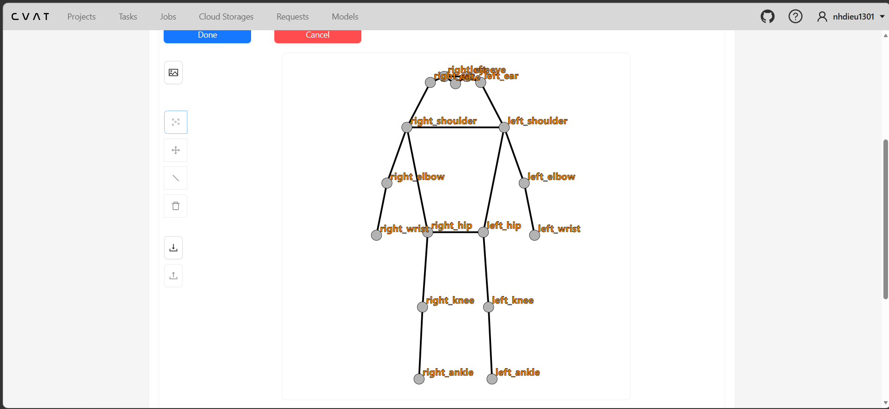
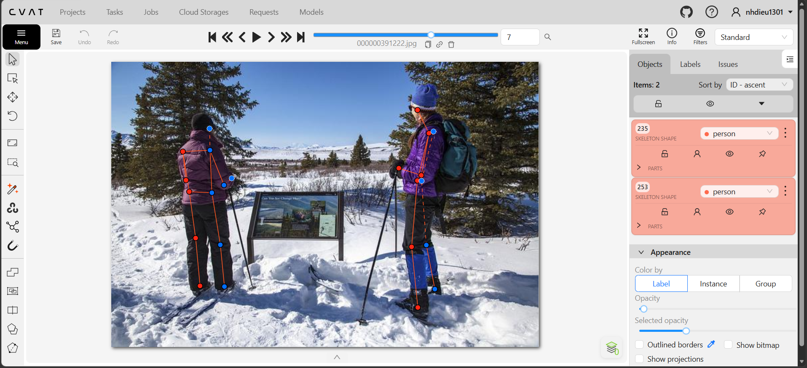
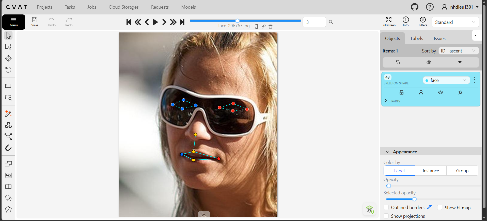
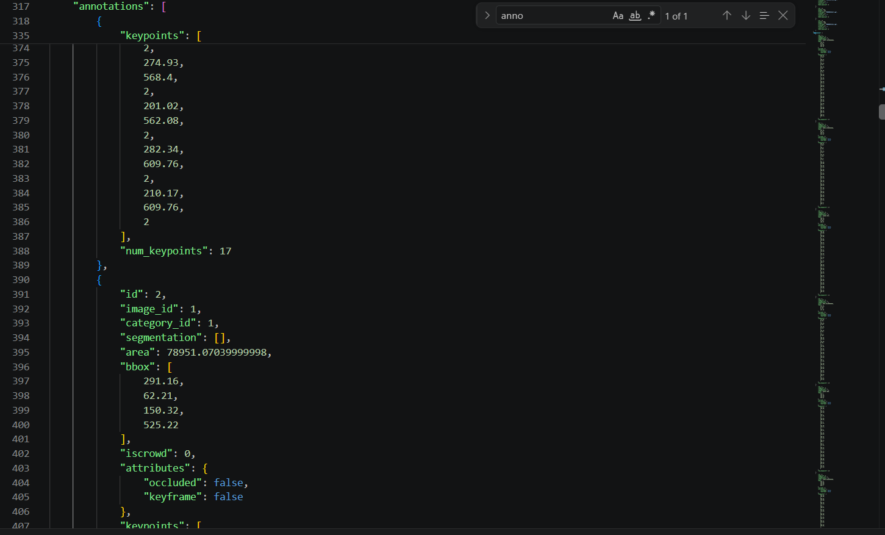

# Báo cáo cá nhân — NguyenHoangDieu-2A202603174

Dữ liệu: 12 ảnh người COCO val2017 (Lin et al., 2014) và 8 ảnh chân dung Wikimedia Commons, chỉ dùng trong lớp.

## 0. Thông tin học viên

- Họ tên: Nguyễn Hoàng Diệu
- MSSV: 2A202603174
- Email: nhdieu1301@gmail.com
- Link repository: https://github.com/nhdieu1301/K5-L2-2A202603174_NguyenHoangDieu-KeypointPose-Student
- Phiên bản CVAT (Help → About): 2.82.1
- Máy: hệ điều hành Windows · RAM 16 GB · chạy CVAT chế độ đầy đủ
- Bộ ảnh (`src/exports/assignment.json` do `lab.py setup` tạo): có
- Giờ bắt đầu: 16:30
- Giờ kết thúc: 18:55

## 1. Kiểm tra label (CP0)

| Label | Kiểu | Số điểm | Tên điểm đúng bảng của lab? | Đúng thứ tự? | Số cạnh |
|---|---|---:|---|---|---:|
| `person` | Skeleton | 17 | Có | Có | 19 |
| `face` | Skeleton | 13 | Có | Có | 12 |

Mẫu `person` dựng theo người quay mặt về camera (các điểm `left_*` nằm bên phải khung mẫu)? Có

Cách đổi cờ `occluded` / `outside` cho **một điểm** trên phiên bản CVAT này (một câu):

Click chuột phải trực tiếp vào điểm (node) cần đổi trên khung hình và chọn **Switch occluded property** (icon con mắt) để đặt `occluded`, hoặc chọn **Switch outside property** để đặt `outside` cho riêng điểm đó mà không làm thay đổi trạng thái các điểm còn lại của skeleton.

## 2. Số lượng đã gán và thời gian (CP1, CP2)

| Nhóm ảnh | Số ảnh | Số skeleton đã gán | Số người dưới 60 px (không gán) | Số poster / gương / màn hình bỏ qua | Thời gian (phút) |
|---|---:|---:|---:|---:|---:|
| `easy` | 5 | 7 | 0 | 0 | 25 |
| `occluded` | 3 | 5 | 1 | 0 | 22 |
| `back` | 2 | 4 | 0 | 0 | 16 |
| `small` | 1 | 1 | 0 | 0 | 8 |
| `crowd` | 1 | 3 | 1 | 0 | 15 |
| `faces` | 8 | 8 | — | 0 | 24 |

- Số ảnh người đã xong ở mốc phút 105: 9 / 10
- Thời gian thực tế (phút): CP1 86 · CP2 24 · CP3 18
- Ảnh tốn thời gian nhất là ảnh nào, vì sao?

Ảnh `000000130816.jpg` thuộc nhóm `crowd` tốn nhiều thời gian nhất vì có nhiều người đứng gần nhau, cần đo kỹ chiều cao đối tượng để loại bỏ nhân vật dưới 60 px, xác định hướng giải phẫu từng người và phân loại chính xác các khớp bị che khuất (`v = 1`) với các khớp ngoài khung hình (`v = 0`).

## 3. Bảng ca khó (CP1, CP2)

| Ảnh | Người / mặt | Điểm | Cờ đã chọn | Phân vân giữa | Lý do chọn |
|---|---|---|---:|---|---|
| 000000056651.jpg | #2 | `left_ear` | `v = 0` | `v = 1` và `v = 0` | Tai trái nằm sát mép biên ảnh (`x = 639`), phần đầu bị cắt ra ngoài khung hình nên chọn `outside` (`v = 0`) thay vì kéo điểm về sát mép ảnh. |
| 000000056651.jpg | #2 | `left_wrist`, `right_wrist` | `v = 2` | `lr_swap` hay bắt chéo thật | Nhân vật khoanh/bắt chéo hai tay trước thân nên cổ tay trái nằm về phía bên phải thân và ngược lại; kiểm tra kỹ theo cẳng tay để giữ đúng nhãn giải phẫu. |
| 000000572411.jpg | #1 | `left_wrist`, `right_wrist` | `v = 2` | `lr_swap` hay bắt chéo thật | Tư thế tay bắt chéo qua trục giữa cơ thể; lần theo đường nối từ vai → khuỷu tay → cổ tay xác nhận không bị đổi nhầm trái/phải. |
| 000000130816.jpg | #4 (cũ) | Toàn thân | Bỏ gán | Gán `person` hay bỏ qua | Nhân vật có chiều cao toàn thân đo được chỉ khoảng 51 px (< 60 px) nên xóa skeleton theo đúng quy định của guideline. |

## 4. Bảng tự review (CP3)

| Ảnh | Người / mặt | Điểm | Mã lỗi | Ghi chú | Đã sửa? |
|---|---|---|---|---|---|
| 000000572411.jpg | #1 | `left_wrist`, `right_wrist` | ok | Xác nhận tư thế bắt chéo tay thật sự, không bị `lr_swap` | Không |
| 000000056651.jpg | #2 | `left_ear` | vis_flag | Điểm nằm sát mép ảnh (639, 181), chuyển từ `occluded` (`v = 1`) sang `outside` (`v = 0`) | Có |
| 000000130816.jpg | #4 | Toàn thân | extra | Nhân vật cao 51 px (< 60 px), đã xóa skeleton dư thừa | Có |
| 000000467300.jpg | #1 | `left_hip`, `right_hip` | position | Chỉnh lại vị trí điểm hông từ cạp quần xuống đúng tâm khớp hông | Có |
| 000000391222.jpg | #1 | — | ok | Người quay lưng, đúng hướng trái/phải giải phẫu và cờ visibility | Không |
| face_186226.jpg | #1 | `left_eye_*` | ok | Kính râm tối màu, 4 điểm mắt đặt theo gọng kính với cờ `occluded` (`v = 1`) | Không |
| face_296767.jpg | #1 | `mouth_left`, `mouth_right` | position | Tinh chỉnh lại 2 điểm khóe miệng về đúng góc giao môi trên và môi dưới | Có |
| face_137371.jpg | #1 | — | ok | Đủ 13 điểm, mí mắt đặt sát mép mí ngay trên/dưới tâm con ngươi | Không |

Tổng hợp số lỗi theo mã:

| `lr_swap` | `vis_flag` | `position` | `missing` | `extra` | `ok` |
|---:|---:|---:|---:|---:|---:|
| 0 | 1 | 2 | 0 | 1 | 4 |

Điểm còn phân vân giữa `v = 1` và `v = 0` (ghi cả hai lựa chọn và lý do chọn):

Tại điểm `left_ear` của người `#2` trong ảnh `000000056651.jpg`, có hai lựa chọn: đặt `v = 1` (`occluded`) ngay sát mép phải khung hình hoặc đặt `v = 0` (`outside`). Cuối cùng chọn `v = 0` vì phần tai thực tế nằm ngoài biên ảnh; đặt `v = 1` sát mép ảnh sẽ tạo nhãn tọa độ biên giả làm sai lệch quá trình huấn luyện model.

## 5. Kiểm file xuất và kết quả tự kiểm (CP4)

Tự kiểm tay trong file JSON:

| File | Người / mặt kiểm (ảnh, thứ tự) | Số phần tử `keypoints` | Điểm `outside` ra `v = 0`, `occluded` ra `v = 1`? | `num_keypoints` khớp? |
|---|---|---:|---|---|
| `NguyenHoangDieu_persons.zip` | `000000056651.jpg`, #2 | 51 | Có | Có |
| `NguyenHoangDieu_persons.zip` | `000000572411.jpg`, #1 | 51 | Có | Có |
| `NguyenHoangDieu_faces.zip` | `face_137371.jpg`, #1 | 39 | Có | Có |

Sau khi xuất, CVAT ghi `occluded` thành `v = 1` và `outside` thành `v = 0`. Tọa độ của điểm `outside` trong file là `0, 0` hay tọa độ cũ? **Tọa độ cũ (CVAT 2.x giữ lại tọa độ node trên canvas nhưng gắn cờ `v = 0` để bộ đọc chuẩn COCO bỏ qua).**

Hai job đã chuyển sang completed trên CVAT? **Có**

Dán phần **TÓM TẮT** in ra từ `src/check_submission.py`:

~~~text
- File person: NguyenHoangDieu_persons.zip
  Số ảnh: 12 · số skeleton `person`: 20 · mỗi annotation 51 số
  Skeleton theo ảnh: 000000030960=2, 000000043500=2, 000000056651=2, 000000130816=3, 000000137767=1, 000000156069=1, 000000201702=1, 000000391222=2, 000000429594=1, 000000467300=2, 000000525227=1, 000000572411=2
  Cờ v: v=2 238 (70%) · v=1 45 (13%) · v=0 57 (17%)
  num_keypoints trung bình: 14.2
- File face: NguyenHoangDieu_faces.zip
  Số ảnh: 8 · số skeleton `face`: 8 · mỗi annotation 39 số
  Skeleton theo ảnh: face_137371=1, face_145751=1, face_186226=1, face_296767=1, face_3348=1, face_442231=1, face_496353=1, face_560526=1
  Cờ v: v=2 88 (85%) · v=1 8 (8%) · v=0 8 (8%)
  num_keypoints trung bình: 12.0
- Ghi chú: 65 điểm v = 0 vẫn mang tọa độ cũ (CVAT 2.x xuất như vậy; chuẩn COCO ghi 0, 0). Không phải lỗi: điểm v = 0 bị bỏ qua khi huấn luyện và khi chấm.
- Số [LỖI]: 0 · số [CẢNH BÁO]: 2
Kết quả: ĐẠT (đọc lại từng cảnh báo ở trên)
~~~

Các `[CẢNH BÁO]` còn giữ nguyên và lý do:

- `[CẢNH BÁO] 000000056651.jpg #2: cặp wrist nằm ngược phía so với các cặp còn lại`: Giữ nguyên vì nhân vật thực sự bắt chéo hai tay qua thân, vị trí `left_wrist` và `right_wrist` đã được kiểm tra dọc theo cẳng tay và đúng hoàn toàn về mặt giải phẫu.
- `[CẢNH BÁO] 000000572411.jpg #1: cặp wrist nằm ngược phía so với các cặp còn lại`: Giữ nguyên vì nhân vật ở tư thế bắt chéo tay thật sự, không phải lỗi đổi nhầm trái/phải (`lr_swap`).

## 6. Ảnh chụp màn hình

1. Label `person` trong label constructor (đủ 17 điểm có tên):

   

2. Một người quay lưng đã gán, cờ đã đặt:

   

3. Một khuôn mặt đã gán 13 điểm, phóng to vùng mắt:

   

4. Một đoạn JSON xuất của một người:

   

Nguồn ảnh: COCO val2017 / Wikimedia Commons.

## 7. Tự đánh giá

1. Lỗi bạn mắc nhiều nhất hôm nay, và cách bạn sẽ tránh ở dự án thật:

   Lỗi dễ mắc nhất là nhầm lẫn ranh giới giữa điểm bị che khuất (`v = 1`) với điểm nằm sát mép ngoài khung hình (`v = 0`), cũng như ước lượng chiều cao đối tượng nhỏ gần ngưỡng 60 px. Trong dự án thật, cần luôn xác định hướng giải phẫu trước khi kéo điểm, bật hiển thị tên nhãn trên canvas và thực hiện tự rà soát theo thứ tự ngược từ cuối lên đầu để phát hiện các đường nối hoặc cờ visibility bất thường.

2. Một quy tắc bạn đề xuất thêm vào guideline (kèm ảnh ví dụ nếu có):

   Đề xuất bổ sung quy định định lượng cho vùng biên ảnh: nếu tâm khớp dự đoán nằm cách mép khung hình dưới 3–5 px và phần lớn chi thể đã bị cắt ra ngoài khung hình thì bắt buộc gán `v = 0` (`outside`) thay vì cố đặt `v = 1` sát mép.

3. Nhãn của bạn đi vào model ở đâu? Chọn một lỗi bạn đã sửa và nói nó sẽ làm model học sai thế nào (heatmap, trọng số trong loss, hay bước lật ảnh):

   Trong các mô hình pose 2D, mỗi điểm có `v > 0` sinh ra một đỉnh Gaussian trên heatmap mục tiêu, cờ `v` quyết định trọng số tính điểm đó vào hàm loss, và các cặp `left_*` / `right_*` được tráo đổi tên cho nhau khi tăng cường dữ liệu bằng phép lật ảnh ngang (horizontal flip). Với lỗi `vis_flag` (gán nhầm điểm ngoài khung hình thành `v = 1` sát mép ảnh) mà tôi đã sửa, nếu giữ nguyên thì điểm đó sẽ có trọng số dương trong hàm loss và tạo đỉnh heatmap giả ngay tại đường biên ảnh, làm model học sai phân bố không gian của khớp khi vật thể bị cắt một phần.

## 8. Khó khăn và lỗi kỹ thuật

- Quá trình khởi tạo task bằng `lab.py` chạy ổn định. Trong bước tự kiểm xuất hiện cảnh báo với các tư thế tay bắt chéo và điểm sát mép ảnh, đã mở lại job trên CVAT để đối chiếu trực tiếp từng trường hợp và cập nhật lại file xuất đạt chuẩn.

## 9. Tài liệu tham khảo và công cụ AI đã dùng

- Tài liệu hướng dẫn Lab Ngày 4 (`docs/GUIDELINE.md`, `docs/CVAT_CHEATSHEET.md`, `docs/COCO_KEYPOINTS.md`).
- Lin, T. Y., et al. (2014). *Microsoft COCO: Common Objects in Context*.
- Công cụ AI đã dùng: Trợ lý AI hội thoại (Gemini) để giải thích các cảnh báo từ script tự kiểm `src/check_submission.py`, rà soát quy định định dạng file nộp và cấu trúc báo cáo.